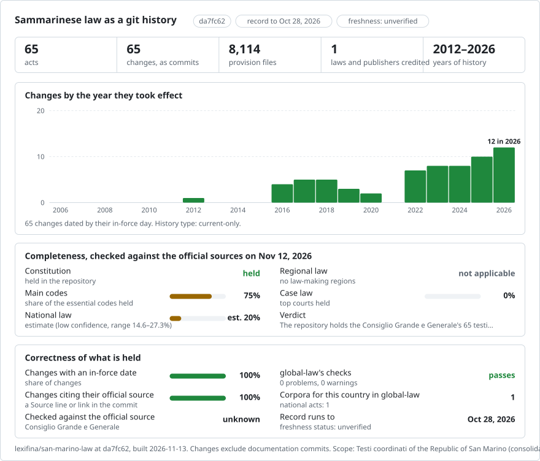

# San Marino: law history in git

**English** · **[Oppure leggilo in italiano](README.md)**

<picture>
<source media="(prefers-color-scheme: dark)" srcset="data/effort-dark.svg">

</picture>

The law of San Marino as a git repository: one file per article, one paragraph per line, and one commit per consolidated text ("testo coordinato"), dated by the day the Consiglio Grande e Generale says the text is updated to. The Consiglio publishes only the current edition of each text, so each is one commit for now, credited to the office that prepares it; later editions will be added as further commits, and `git log` will list them. Each article's footnotes keep the earlier wording ("Testo originario") and the act that changed it; picking a date gives the edition current that day.

Part of [lexifina/global-law](https://github.com/lexifina/global-law), one git history for every country's law: this is San Marino's national law, which global-law reads at `san-marino/national/acts/`.

**What is in it now:** 65 testi coordinati on the main subjects of San Marino law, one edition each, updated between 20 January 2012 and 28 October 2026, holding 526 acts (409 different ones; some are printed in more than one text) and 7,535 articles, among them the Declaration of Citizens' Rights (Legge 8 luglio 1974 n.59) as amended to 2025; their footnotes name 394 amending acts. [`laws.csv`](laws.csv) lists every text with its date; [`data/acts.csv`](data/acts.csv) lists the acts in each text.

Each text is a folder named after its subject, with one folder per act named by kind, year and number and one file per article (`lavoro/legge-1961-7/art-23.md` is Article 23 of Legge 17 febbraio 1961 n.7, the Labour Protection Law, in the labour collection); `index.txt` lists a text's files in reading order.

The text is in Italian, San Marino's official language, as the Consiglio publishes it. An English translation is not part of this record.

## Questions as git commands

| Question | Command |
| --- | --- |
| Every edition of Article 23 of the Labour Protection Law (one so far) | `git log -p --word-diff -- lavoro/legge-1961-7/art-23.md` |
| Which acts changed the Law, as its footnotes name them? | `grep lavoro/legge-1961-7/ data/amendments.csv` |
| Every edition of the labour collection, with the day it is updated to | `git log --format="%h %(trailers:key=In-force,valueonly,separator=) %an" -- lavoro` |
| Article 23 in the edition current on 1 January 2026 | `python tools/in_force_on.py 2026-01-01 lavoro/legge-1961-7 art-23` |

**Outside git**, we also host this record publicly, for free:

- **[Ask Claude about Sammarinese law](https://global-law.lexifina.com/v1/try_claude?country=san-marino)**: opens Claude with a first question ready.
- **[Ask ChatGPT](https://global-law.lexifina.com/v1/try_chatgpt?country=san-marino)**: the same question in ChatGPT.
- **[Search Sammarinese law on our site](https://lexifina.com/law?country=san-marino&q=ferie)**: a search for "ferie", with each provision's text and its versions, no account needed.
- **[Developer REST API](https://global-law.lexifina.com/v1/search_law?query=ferie&jurisdiction=san-marino)**: the same search as JSON, with no key. See the [documentation here](https://lexifina.com/api/global-law).

Both assistants read the record through the free Global law connector (MCP, `https://global-law.lexifina.com/mcp`); the first time, the chat gives you the link that adds it. Ask in Italian or in English.

**Host it yourself easily.** All it takes is git and Python, and the tools run on your machine:

```sh
git clone --depth 1 https://github.com/lexifina/global-law && cd global-law
python3 tools/countries.py add san-marino/national/acts
python3 tools/law.py show 2026-01-01 san-marino/national/acts/lavoro/legge-1961-7/art-23.md
```

Opened in Claude Code, Cursor, VS Code or Codex, the clone also starts a local MCP server with the same tools ([MCP.md](https://github.com/lexifina/global-law/blob/main/MCP.md)).

## Dates

Each commit is dated at noon, Europe/San_Marino, on the day the text says it is updated to ("aggiornato al 22 dicembre 2025"), and carries it in its `In-force:` and `Consolidated:` trailers:

- 63 texts give a full date; 1 gives only a month ("vigente a maggio 2026") and is dated the first of that month; 1 gives none and is dated by the day it was retrieved, 28 October 2026. The `Date-source:` trailer says which.
- The date is the day of the consolidation, not the day any amendment took effect: those days are in the amending acts the footnotes name.
- `tools/in_force_on.py` answers for any date on or after a text's edition; for an earlier date it says there is no version, because the source has none.

Every law-text commit is credited to `Segreteria Istituzionale (Consiglio Grande e Generale)`, the office that prepares the consolidation, with `Kind: consolidated`. No line is credited to an amending act, because without an earlier edition no one can show which words an amendment wrote; a later edition's changes will be credited to an act where its footnotes name one.

## How it is checked

- The letters and digits of every text, in order, are compared with the Consiglio's own copy without notes ("SENZA NOTE", 33 texts), read by a different PDF reader: 0.17% of 925,721 words differ, most where the two PDFs themselves differ.
- The words of every text are compared with its PDF with notes: 99.98% of the PDF's words are in the repository (the lowest text 99.35%).
- Every commit's trailers parse; there are no merges, no dates that go back and none after the build date.
- The build is deterministic: from the same files, whose sha256 are in [`data/source-sha256.tsv`](data/source-sha256.tsv), it gives the same commit hashes. The results are in [`data/verification.json`](data/verification.json) and [`REPRODUCE.md`](REPRODUCE.md).
- [vulnerabilities/](vulnerabilities/README.en.md): possible drafting mistakes in San Marino law, found by global-law's detectors and checked by hand.

## What it does not show

- **Any edition before the current one.** The Consiglio keeps none; earlier wording is only in the footnotes.
- **Laws not in a testo coordinato.** The Consiglio's archive has every law and decree as enacted; they are not here, and neither are case law, treaties or bills.
- **Pictures, tables drawn as graphics, page numbers and the PDF's layout.**
- **Text the PDF itself garbles**: a few PDFs have letters with no Unicode mapping, shown as `�`; notes with no call and calls with no note are listed in [`data/issues.csv`](data/issues.csv).

## Sources

| Source | Kind | Past versions | Notes |
| --- | --- | --- | --- |
| [Consiglio Grande e Generale, Testi coordinati](https://www.consigliograndeegenerale.sm/on-line/home/testi-coordinati.html) (Segreteria Istituzionale) | Official consolidated texts, by subject | no, the current edition only | PDF with footnotes (earlier wording, amending acts); only the Bollettino Ufficiale is authoritative |

## Licence

See [`LICENSE`](LICENSE) and [`SOURCES.md`](SOURCES.md). The texts are acts of the State, which Legge 25 gennaio 1991 n.8, article 98(f), allows anyone to reproduce in full; the wording is unchanged, only split into files and lines. Lexifina's own contributions are CC0 1.0.

No AI model wrote or changed legal text, and none runs when the repository is built or checked; the scripts were written by an AI model (see [`REPRODUCE.md`](REPRODUCE.md)).

## Visualisations

- [visualisations/](visualisations/README.en.md): charts drawn from this repository. Not drawn yet.

## More

From [lexifina/global-law](https://github.com/lexifina/global-law):

- [FEATURES.md](https://github.com/lexifina/global-law/blob/main/FEATURES.md): every feature, and what every corpus must support (`git blame`, `law.py`, the MCP tools)
- [FAQ.md](https://github.com/lexifina/global-law/blob/main/FAQ.md): questions and answers · [CONTRIBUTING.md](https://github.com/lexifina/global-law/blob/main/CONTRIBUTING.md): proposing changes · [MCP.md](https://github.com/lexifina/global-law/blob/main/MCP.md): the MCP server · [REPRODUCE.md](https://github.com/lexifina/global-law/blob/main/REPRODUCE.md): how it was built · [CHANGELOG.md](https://github.com/lexifina/global-law/blob/main/CHANGELOG.md)
- [FRESHNESS.md](https://github.com/lexifina/global-law/blob/main/FRESHNESS.md): how current each corpus is · [Monitoring](https://github.com/lexifina/global-law/tree/main/monitoring): whether updates are running · [WATCHING.md](https://github.com/lexifina/global-law/blob/main/WATCHING.md): how each official source is watched for changes
- [performance/](https://github.com/lexifina/global-law/tree/main/performance): how fast the tools are, measured
- [visualisations/](https://github.com/lexifina/global-law/tree/main/visualisations): charts and bridges across the world's law
- [Vulnerabilities](https://github.com/lexifina/global-law/tree/main/vulnerabilities): mistakes in legislation as published
