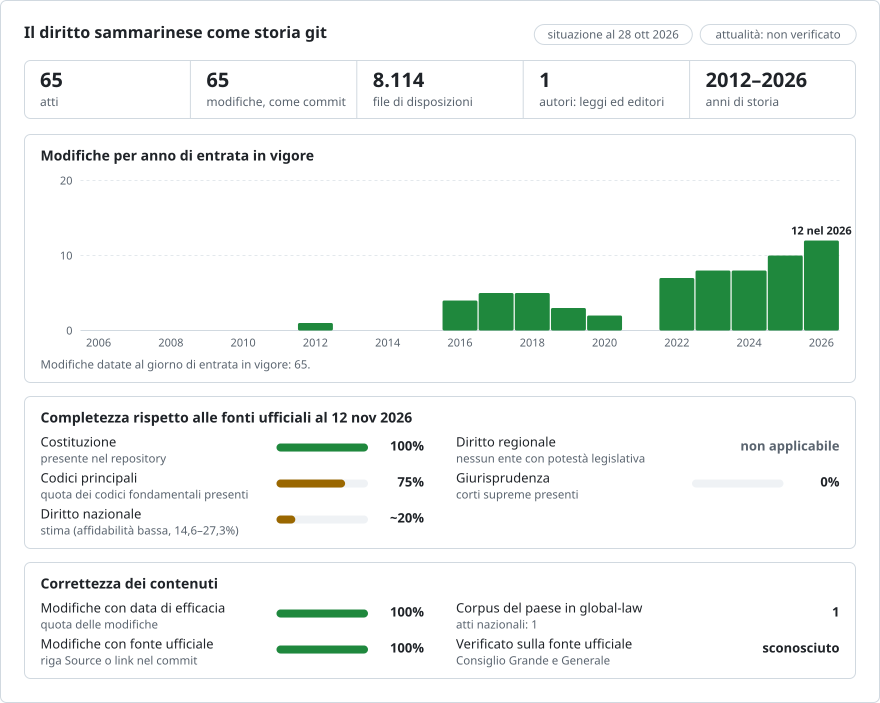

# Le leggi di San Marino, come repository git

**Italiano** · [English](README.en.md)

<picture>
<source media="(prefers-color-scheme: dark)" srcset="data/it/effort-dark.svg">

</picture>

Fa parte di [lexifina/global-law](https://github.com/lexifina/global-law), un'unica storia git per il diritto di ogni Paese: questo è il diritto nazionale di San Marino, che global-law legge in `san-marino/national/acts/`.

I testi coordinati della Repubblica di San Marino come repository git: 65 testi sulle principali materie del
diritto sammarinese, che comprendono 526 atti e 7.535 articoli, tratti dal sito del
[Consiglio Grande e Generale](https://www.consigliograndeegenerale.sm/on-line/home/testi-coordinati.html). Ogni
articolo è un file, con un comma per riga, così che `git blame` e `git diff` funzionino riga per riga. Il testo è in
italiano, così come è pubblicato.

**Che cosa questo repository non è, per ora: una storia.** Il Consiglio Grande e Generale pubblica solo l'edizione
vigente di ciascun testo coordinato e non conserva le precedenti. Perciò ogni testo è un unico commit che ne contiene
l'intera formulazione vigente ("current-only"), datato al giorno a cui il testo dichiara di essere aggiornato. Prima
di quell'edizione non c'è una storia riga per riga. Le edizioni successive saranno aggiunte come commit successivi,
quindi la storia cresce in avanti da qui. Ciò che la fonte dice del passato è conservato: le note riportano la
formulazione precedente di ogni disposizione ("Testo originario") e le disposizioni modificative ("Modifiche
legislative"), e si trovano nei file e sono elencate in [`data/amendments.csv`](data/amendments.csv).

L'archivio contiene 65 testi, aggiornati tra il 2012-01-20 e il 2026-10-28, in 66 commit. Non sono tutte le leggi
sammarinesi: solo quelle che il Consiglio ha riunito in un testo coordinato (vedi [`laws.csv`](laws.csv)).

## Le domande di un giurista, come comandi git

| Domanda | Comando |
| --- | --- |
| Che cosa dice l'articolo 1 del Codice Penale? | `python tools/in_force_on.py 2026-10-29 nuovo-codice-penale/legge-1974-17 art-1` |
| Un intero atto di un testo, in ordine | `python tools/in_force_on.py 2026-10-29 nuovo-codice-penale/legge-1974-17` |
| Un intero testo coordinato | `python tools/in_force_on.py 2026-10-29 patrocinio-gratuito` |
| La formulazione precedente di un articolo e l'atto che l'ha modificata | le note `[^n]:` alla fine del suo file |
| Ogni disposizione toccata da un atto modificativo, secondo le note | `grep -i 'Legge 2 marzo 2022 n.24' data/amendments.csv` |
| Quali testi contengono un atto | `grep 'legge-2011-160' data/acts.csv` |
| Che cosa è cambiato in un testo da questa costruzione (dopo costruzioni successive) | `git log -p -- nuovo-codice-penale` |
| L'elenco dei testi, con le loro date | [`laws.csv`](laws.csv) |

## Come è organizzato un testo

Ogni testo coordinato è una cartella che prende il nome dalla sua materia. Il suo `title.md` è la copertina: il
titolo, la riga "aggiornato al" e, se il testo lo contiene, l'elenco degli atti che cita. Una "raccolta coordinata"
contiene più atti: ciascuno è una sottocartella denominata per tipo, anno e numero (`legge-2011-160`,
`decreto-delegato-2019-122`), oppure per tipo e data per un atto del XIX secolo privo di numero (`legge-1884-12-20`),
con l'intestazione, il titolo e il preambolo dell'atto in `intro.md` e un file per articolo (`art-1.md`,
`art-2-bis.md`). Un atto così antico numera i suoi articoli all'inizio del loro primo comma ("1. - E' accordato
..."); ciascuno resta comunque un file. Un testo che riporta due volte lo stesso atto ne conserva entrambe le copie
(`art-1--2.md`, `intro--2.md`). Le intestazioni di Titoli, Capi e Sezioni (`## TITOLO I`) vanno in cima all'articolo
che le segue; "ALTRE NORME" (il separatore che precede gli ulteriori atti di una raccolta) apre l'`intro.md` dell'atto
successivo. `index.txt` elenca i file in ordine di lettura.

Il numero di nota in apice nel PDF è scritto `[^n]` nel punto in cui si trova, e la nota segue alla fine dello stesso
file, `[^n]: Testo originario ...`, con ogni comma successivo rientrato di quattro spazi. Le note che nessun punto del
testo richiama (30) sono nel file `notes-uncalled.md` del testo; 9 numeri di nota sono richiamati ma non hanno
alcuna nota nel PDF. Entrambi i casi sono elencati in [`data/issues.csv`](data/issues.csv).

## Le date, e quale usiamo

Ogni testo indica la data a cui è aggiornato ("aggiornato al 22 dicembre 2025"). **Ogni commit è datato a quella
data**, a mezzogiorno ora di San Marino (CET/CEST), nei suoi trailer `In-force:` e `Consolidated:`: il testo è la
legge come il Consiglio l'ha coordinata in quel giorno. 63 testi indicano una data completa. 1 indica solo un mese
("vigente a maggio 2026") ed è datato al primo giorno di quel mese, e 1 non ne indica alcuna ed è datato al giorno in
cui è stato scaricato (2026-10-28); il trailer `Date-source:` dice quale caso ricorre. La data non è quella in cui una
modifica ha avuto effetto: quelle date sono negli atti modificativi, indicati nelle note.

`tools/in_force_on.py` risponde per qualsiasi data uguale o successiva all'edizione di un testo. Per una data
anteriore dice che non esiste alcuna versione, perché la fonte non ne ha.

## Che cosa significa "autore"

Ogni commit di testo normativo ha lo stesso autore: `Segreteria Istituzionale (Consiglio Grande e Generale)
<segreteria-istituzionale@consigliograndeegenerale-sm.invalid>`, con il trailer `Kind: consolidated`. L'indirizzo
non può esistere. L'autore è l'ufficio che predispone il coordinamento, non un legislatore. Nessuna riga è
attribuita a un atto modificativo, perché senza un'edizione precedente nessuno può mostrare quali parole abbia scritto
una modifica. Quando un'edizione successiva cambierà il testo, la modifica sarà attribuita a un atto modificativo
solo dove le nuove note ne indicano uno; altrimenti è etichettata `Kind: unexplained` e ha come autore la Segreteria.

Le note indicano 394 atti distinti in 3.578 righe di `data/amendments.csv`.

## Che cosa non mostra

- Qualsiasi edizione anteriore a quella vigente. Il sito non ne ha.
- Le leggi che non sono in un testo coordinato. L'archivio del Consiglio contiene ogni legge e decreto come
  approvati; qui non ci sono.
- Immagini, tabelle riprodotte come grafica, numeri di pagina e l'impaginazione del PDF (rientri, grassetto).
- Il testo che il PDF stesso altera: alcuni PDF hanno lettere prive di corrispondenza Unicode, mostrate come `�`
  così come le restituisce il PDF.

I testi coordinati sono un ausilio alla lettura: il testo ufficiale di ogni legge è quello del Bollettino Ufficiale,
e il Consiglio lo dichiara. Lo stesso vale per questo repository.

## Come viene verificato

`tools/build/` contiene la costruzione così come è stata eseguita, e [`data/source-sha256.tsv`](data/source-sha256.tsv)
lo sha256 di ogni file scaricato. La costruzione è deterministica: dagli stessi file produce gli stessi hash dei
commit. Vedi [`REPRODUCE.md`](REPRODUCE.md). Prima della pubblicazione sono stati verificati questi aspetti:
- le lettere e le cifre di ogni testo, in ordine, rispetto alla copia senza note del Consiglio stesso ("SENZA NOTE",
  disponibile per 33 testi), letta da un diverso lettore PDF (`pdftotext` di poppler, non PyMuPDF usato dalla
  costruzione); e, per ogni testo, le parole del repository rispetto alle parole del PDF con le note;
- i trailer di ogni commit sono analizzabili; non ci sono merge, né date che tornano indietro né date successive a
  quella della costruzione;
- lo strumento per data, su articoli di esempio in diverse date;
- due costruzioni dagli stessi file producono lo stesso HEAD.

I risultati ([`data/verification.json`](data/verification.json), per i commit normativi di questa costruzione):
rispetto alle copie senza note (33 testi, 925.721 parole), 1.540 parole (0,17%) differiscono, e altre 10.412 sono
solo in un ordine diverso (celle di tabella, che i due lettori prendono in un ordine diverso). La maggior parte delle
differenze si trova dove i due PDF stessi differiscono: indici con altri numeri di pagina, alcune copie senza note
prodotte in un altro giorno, note stampate nella copia senza note. Le restanti si trovano dove l'altro lettore unisce
una parola spezzata a fine riga o due numeri affiancati. Rispetto ai PDF con le note (65 testi, 2.475.831 parole), il
99,98% delle parole del PDF è nel repository (il testo più basso: 99,35%, un decreto i cui allegati sono tabelle
larghe), e 50 testi raggiungono il 99,9% in entrambe le direzioni.

## Come viene costruito

Il download di ogni testo è uno zip con il PDF con le note e, per alcuni, uno "SENZA NOTE"; `unpack.py` ne estrae i
PDF. `parse.py` legge il PDF con le note con PyMuPDF: le righe per linea di base, l'area delle note di ogni pagina
(sotto il separatore delle note a piè di pagina di Word, oppure dal primo numero di nota, alla dimensione e al
margine delle note), i richiami di nota (numeri in apice nel testo), le intestazioni degli atti e gli articoli.
`build.py` scrive un commit per testo con `git fast-import`. Nessun modello di IA partecipa alla costruzione o alla
verifica.

## Licenza

Fonte: Consiglio Grande e Generale, Repubblica di San Marino (https://www.consigliograndeegenerale.sm), Segreteria
Istituzionale. I testi sono atti dello Stato, che la Legge 25 gennaio 1991 n.8, articolo 98, lettera f), consente a
chiunque di riprodurre integralmente. La formulazione non è stata modificata; è stata solo suddivisa in file e righe.
I contributi propri di Lexifina (gli strumenti, l'organizzazione e i messaggi di commit) sono CC0. Vedi
[`LICENSE`](LICENSE) e [`SOURCES.md`](SOURCES.md).

Questa è una traduzione della versione inglese ([README.en.md](README.en.md)); in caso di differenze, prevale la versione inglese.

## Per saperne di più

Dal repository [lexifina/global-law](https://github.com/lexifina/global-law) (pagine in inglese):

- [FEATURES.md](https://github.com/lexifina/global-law/blob/main/FEATURES.md): tutte le funzionalità e ciò che ogni corpus deve supportare (`git blame`, `law.py`, strumenti MCP)
- [FAQ.md](https://github.com/lexifina/global-law/blob/main/FAQ.md): domande e risposte · [CONTRIBUTING.md](https://github.com/lexifina/global-law/blob/main/CONTRIBUTING.md): proporre una modifica · [MCP.md](https://github.com/lexifina/global-law/blob/main/MCP.md): server MCP · [REPRODUCE.md](https://github.com/lexifina/global-law/blob/main/REPRODUCE.md): come è stato realizzato · [CHANGELOG.md](https://github.com/lexifina/global-law/blob/main/CHANGELOG.md)
- [FRESHNESS.md](https://github.com/lexifina/global-law/blob/main/FRESHNESS.md): quanto è aggiornato ogni corpus · [Monitoraggio](https://github.com/lexifina/global-law/tree/main/monitoring): se gli aggiornamenti funzionano · [WATCHING.md](https://github.com/lexifina/global-law/blob/main/WATCHING.md): come ogni fonte ufficiale viene controllata per individuare le modifiche
- [performance/](https://github.com/lexifina/global-law/tree/main/performance): quanto sono veloci gli strumenti, misurato
- [visualisations/](https://github.com/lexifina/global-law/tree/main/visualisations): grafici e collegamenti attraverso il diritto di tutto il mondo
- [Vulnerabilità](https://github.com/lexifina/global-law/tree/main/vulnerabilities): errori nei testi così come sono stati pubblicati
