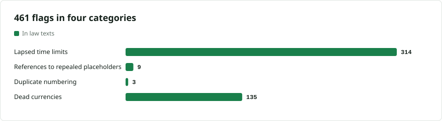

# Vulnerabilities in San Marino law

[Italiano](README.md) · **English**

<picture>
<source media="(prefers-color-scheme: dark)" srcset="img/flags-by-category-dark.svg">

</picture>

The vulnerability detectors from [lexifina/global-law](https://github.com/lexifina/global-law/tree/main/vulnerabilities) look for mechanical mistakes in legislation: a rule applying "until" a date that has passed, a time limit extended only after it had run out, an amount changed in one provision but not in another, a reference to an article that has been repealed. global-law's published list (9 November 2026) has no row for San Marino, although global-law already held this repository (at commit `da7fc62`, with the same 65 texts), so this is a run over this repository only, as it stood at commit [`53083d6`](https://github.com/lexifina/san-marino-law/commit/53083d652fcac0d8857736e27eb71cc75b02260b) on 15 November 2026: the 65 testi coordinati of the Consiglio Grande e Generale, each in its current edition.

**In short:** the detectors raised 461 flags: 314 lapsed time limits, 135 amounts in lire, 9 references to repealed articles and 3 cases of duplicate numbering. More than half (246) are in the notes that each article carries, which quote its earlier wording and the amending acts, not in the text in force. A language model reviewed the 40 strongest lapsed time limits, arguing each one for and against; 6 survived. Checked by hand, none of the 6 is itself a mistake: two are transitional rules that ran out as planned, two flags are a deadline for the Environmental Commission (CTA) to adopt a regulation by 31 December 2017, and two are earlier wording in a note. Reading the notes of one of them, on the extraordinary building amnesty (sanatoria straordinaria, Article 33 of Law No. 94 of 7 August 2017), shows one likely real gap: Decree-Law No. 135 of 5 September 2019 extended the time to apply for the amnesty to 30 September 2020 but left the payment of the remaining 50% due on 30 November 2019; the payment date was moved to 30 September 2020 only by the Council's amendment at ratification, promulgated as Decree-Law No. 14 of 30 January 2020, 61 days after it had passed. Each text in this repository has one edition, so no provision's text changes in its history, and the detectors that compare versions (repeal gaps, same-day conflicts, retroactive dates, empty periods, stale amounts, references to deleted provisions) had nothing to compare. Before the fixes for Italian, the detectors raised 111 flags; the fixes read deadlines ("entro il 30 giugno 2021"), extensions ("prorogato al") and lire written "L.5.000.000" or in words, and stopped reading repeal clauses as repealed articles (below). Later, this will be formalised in Lean, similar to our work on [the US tax code](https://lexifina.com/blog/formalizing-the-us-tax-code) and [US case law](https://lexifina.com/blog/formalizing-all-us-case-law-in-lean).

A flag is a prompt to look, not legal advice, and nothing here has been tested in court.

## Flags by category

| Category | What it looks for | Flags | In law texts | Reviewed | Survived review |
| --- | --- | ---: | ---: | ---: | ---: |
| Lapsed time limits | Text still applying a rule "until" a date that has passed | 314 | 314 | 40 | 6 |
| References to repealed placeholders | A provision citing an article whose text is only "abrogato" or "soppresso" | 9 | 9 | 0 | 0 |
| Duplicate numbering | Two units with the same number in one act | 3 | 3 | 0 | 0 |
| Dead currencies | Amounts in currencies no longer in use | 135 | 135 | 0 | 0 |

"In law texts" counts every testo coordinato: all 65 are law (laws, constitutional and qualified laws, decrees, delegated decrees, decree-laws and regulations). The other files are the READMEs, `REPRODUCE.md`, `SOURCES.md`, the licence, `laws.csv`, `corpus.json`, `data/` and `tools/`; none has a flag. Each text's file holds the article and, after it, the Segreteria Istituzionale's notes, which quote the earlier wording ("Testo originario") and the amending provisions; the detectors read them as text. Of the flags, 165 lapsed time limits, 70 amounts in lire, 8 of the 9 references and all 3 duplicate numbers are in those notes. Of the 149 lapsed time limits in the text in force, 25 have a date after the day to which their testo coordinato is updated: the text may have been changed since, and this record cannot show it. The history has 65 commits that make a version (`Kind: consolidated`, one edition of each text, credited to the Segreteria Istituzionale), all of them counted as law; the other 10 commits are documentation. The time-limit search now reads "entro il", "entro e non oltre il", "non oltre il", "fino alla data del", "sino alle ore ... del", "prorogato al" (and "differito", "posticipato", "rinviato") and the end of a period ("dal 1 luglio 2023 al 30 settembre 2023"); "fino al" and "sino al" were read before. Lapsed time limits went from 69 to 314. It does not read a month or a year without a day ("entro il mese di dicembre 2020", "sino al periodo d'imposta 2017"), nor relative terms ("entro trenta giorni").

*Edge cases: the 6 flags that survived the review, grouped by what they turned out to be, the gap in the amnesty's payment date, and what the other flags are, in [EDGE-CASES.en.md](EDGE-CASES.en.md).*

## Problems found in this repository

- **Articles quoted inside an article are cut out into files of their own.** Article 148(8) of Law No. 166 of 16 December 2013 (general income tax) sets out the wording in which Articles 13, 16, 17, 25, 102, 103 and 104 apply "fino al 31 dicembre 2025". The repository cuts Article 148 at each quoted heading: [`art-148.md`](https://github.com/lexifina/san-marino-law/blob/53083d652fcac0d8857736e27eb71cc75b02260b/imposta-generale-sui-redditi/legge-2013-166/art-148.md) stops inside the quoted Article 13, the quoted articles are `art-16--2.md` to `art-104--2.md`, and Article 148's paragraphs 9 to 13-quater and its note (its earlier wording and the seven laws that moved the end of comma 8 from 2017 to 2025) are at the end of [`art-104--2.md`](https://github.com/lexifina/san-marino-law/blob/53083d652fcac0d8857736e27eb71cc75b02260b/imposta-generale-sui-redditi/legge-2013-166/art-104--2.md#L39-L89), as if they were Article 104. The other 300 or so files named `art-N--2.md` and the like were not checked; some are the articles of annexes, which have numbering of their own.
- **The Environmental Code's notes copied into an annex.** In [`codice-ambientale/decreto-delegato-2012-44/art-1--8.md`](https://github.com/lexifina/san-marino-law/blob/53083d652fcac0d8857736e27eb71cc75b02260b/codice-ambientale/decreto-delegato-2012-44/art-1--8.md#L78-L142) (annexes T to Z1, among them the forms for radio and power installations), the forms' own footnote markers, and the "2" of "mm²", are read as calls of the notes of Delegated Decree No. 44 of 27 April 2012, so the Code's notes 1 to 8, among them the earlier wording of Articles 3 to 6, which `art-3.md` to `art-6.md` already hold, are copied at the end of the annex (lines 142 to 370), while the forms' own footnote stays in the text (line 78, "[^2]Il codice gestore ..."). One of the 6 flags that survived the review is in that copy.

## Files

| File | What it holds |
| --- | --- |
| [data/flags.csv](data/flags.csv) | Every flag, one row per provision and issue |
| [data/reviewed.csv](data/reviewed.csv) | The 40 flags the model reviewed, with its verdict and reason |
| [data/by_category.csv](data/by_category.csv) | The counts in the table above |
| [tools/](tools/) | The scripts that made this run |

Columns: `category` and `category_it` (the category in English and Italian), `detector`, `kind` (`law` or `other`), `path` (the file in this repository), `date` (the date the flag turns on), `reference` (the act or line involved), `summary`, `score` (the detector's ranking, 0 to 1), `review` (`artefact`, `lawful` or `candidate_defect`), `survives_rebuttal`, `review_note` (the model's reason, in English), `url` (the file at the commit that was read).

## How it was made

- **Detectors:** global-law's [vulnerabilities/scripts](https://github.com/lexifina/global-law/tree/main/vulnerabilities/scripts), with the fixes in [tools/](tools/README.md) (among them `patch_it.py`, the fixes for Italian), run on this repository at commit `53083d6`. The history table the detectors read was built from this repository's own commits (the author, and the `In-force` and `Kind` trailers); the 65 editions, `Kind: consolidated`, count as law. The corpus language is Italian.
- **Model review:** gpt-5.4-mini, the 40 strongest flags per category, and for lapsed time limits also the 40 strongest in law texts, which here are the same 40; one pass says whether a flag is real, a second argues that it is not. Where a flag was reviewed twice, the later review is kept. There were no empty periods to review, and the model does not review references to repealed placeholders, duplicate numbering or dead currencies.
- **Hand check:** the 6 flags that survived were read in the texts and their notes in this repository, and so were the 9 references, the 3 duplicate numbers and samples of the other lapsed time limits and of the lire. For the building amnesty, Decree-Law No. 135 of 5 September 2019 and Decree-Law No. 14 of 30 January 2020 were read as the Consiglio Grande e Generale publishes them. The other acts were not compared with the Bollettino Ufficiale.

To report a correction, open an issue with the provision and an official source.

## Licence

The lists and notes are Lexifina's, dedicated to the public domain under CC0 1.0, like the rest of this repository's own contributions. Quoted law text is the Consiglio Grande e Generale's testi coordinati, acts of the State, which Law No. 8 of 25 January 1991, Article 98(f), allows anyone to reproduce in full. See [LICENSE](../LICENSE).
