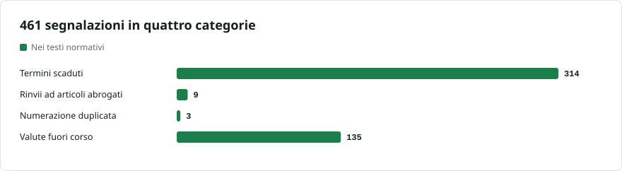

# Vulnerabilità nel diritto sammarinese

**Italiano** · [English](README.en.md)

<picture>
<source media="(prefers-color-scheme: dark)" srcset="img/flags-by-category-dark.it.svg">

</picture>

I rilevatori di vulnerabilità di [lexifina/global-law](https://github.com/lexifina/global-law/tree/main/vulnerabilities) cercano errori meccanici nella legislazione: una norma che si applica "fino al" giorno ormai trascorso, un termine prorogato solo dopo la sua scadenza, un importo modificato in una disposizione ma non in un'altra, un rinvio a un articolo abrogato. L'elenco pubblicato da global-law (9 novembre 2026) non contiene alcuna riga per San Marino, benché global-law disponesse già di questo repository (al commit `da7fc62`, con gli stessi 65 testi); questa è quindi un'analisi del solo repository, nello stato del commit [`53083d6`](https://github.com/lexifina/san-marino-law/commit/53083d652fcac0d8857736e27eb71cc75b02260b) del 15 novembre 2026: i 65 testi coordinati del Consiglio Grande e Generale, ciascuno nell'edizione vigente.

**In breve:** i rilevatori hanno prodotto 461 segnalazioni: 314 termini scaduti, 135 importi in lire, 9 rinvii ad articoli abrogati e 3 casi di numerazione duplicata. Più della metà (246) si trova nelle note che accompagnano ciascun articolo, le quali riportano la formulazione precedente e gli atti modificativi, e non nel testo vigente. Un modello linguistico ha esaminato i 40 termini scaduti più rilevanti, argomentando per ciascuno a favore e contro; ne sono rimasti 6. Verificato a mano, nessuno dei 6 è di per sé un errore: due sono norme transitorie esauritesi come previsto, due segnalazioni riguardano il termine del 31 dicembre 2017 entro il quale la Commissione per la Tutela Ambientale (CTA) doveva adottare un regolamento, e due sono formulazioni precedenti riportate in nota. La lettura delle note di una di esse, sulla sanatoria straordinaria edilizia (articolo 33 della Legge 7 agosto 2017 n.94), rivela invece un probabile vuoto reale: il Decreto-Legge 5 settembre 2019 n.135 ha prorogato al 30 settembre 2020 il termine per presentare la domanda di sanatoria, ma ha lasciato al 30 novembre 2019 il versamento del restante 50%; il termine di versamento è stato spostato al 30 settembre 2020 solo con l'emendamento approvato dal Consiglio in sede di ratifica, promulgato come Decreto-Legge 30 gennaio 2020 n.14, 61 giorni dopo la sua scadenza. Ogni testo di questo repository ha un'unica edizione, quindi il testo di nessuna disposizione cambia nella storia, e i rilevatori che confrontano le versioni (vuoti dopo l'abrogazione, modifiche dello stesso giorno, vigenza anteriore alla pubblicazione, periodi scoperti, importi non aggiornati, rinvii a disposizioni soppresse) non avevano nulla da confrontare. Prima delle correzioni per l'italiano i rilevatori producevano 111 segnalazioni; le correzioni leggono i termini ("entro il 30 giugno 2021"), le proroghe ("prorogato al") e le lire scritte "L.5.000.000" o in lettere, e non scambiano più le clausole abrogative per articoli abrogati (vedi sotto). In seguito tutto ciò sarà formalizzato in Lean, come il nostro lavoro sul [codice tributario degli Stati Uniti](https://lexifina.com/blog/formalizing-the-us-tax-code) e sulla [giurisprudenza statunitense](https://lexifina.com/blog/formalizing-all-us-case-law-in-lean).

Una segnalazione è un invito a esaminare il testo, non una consulenza legale, e nulla di quanto qui esposto è stato sottoposto a un giudice.

## Segnalazioni per categoria

| Categoria | Che cosa cerca | Segnalazioni | Nei testi normativi | Esaminate | Confermate dopo l'esame |
| --- | --- | ---: | ---: | ---: | ---: |
| Termini scaduti | Un testo che applica ancora una norma "fino al" giorno ormai trascorso | 314 | 314 | 40 | 6 |
| Rinvii ad articoli abrogati | Una disposizione che rinvia a un articolo il cui testo è soltanto "abrogato" o "soppresso" | 9 | 9 | 0 | 0 |
| Numerazione duplicata | Due partizioni con lo stesso numero nello stesso atto | 3 | 3 | 0 | 0 |
| Valute fuori corso | Importi in valute non più in uso | 135 | 135 | 0 | 0 |

"Nei testi normativi" comprende tutti i testi coordinati: tutti e 65 sono diritto (leggi, leggi costituzionali e qualificate, decreti, decreti delegati, decreti-legge e regolamenti). Gli altri file sono i README, `REPRODUCE.md`, `SOURCES.md`, la licenza, `laws.csv`, `corpus.json`, `data/` e `tools/`; nessuno ha segnalazioni. Il file di ciascun articolo contiene l'articolo e, di seguito, le note della Segreteria Istituzionale, che riportano la formulazione precedente ("Testo originario") e le disposizioni modificative; i rilevatori le leggono come testo. Si trovano in queste note 165 termini scaduti, 70 importi in lire, 8 dei 9 rinvii e tutti e 3 i casi di numerazione duplicata. Dei 149 termini scaduti nel testo vigente, 25 hanno una data successiva al giorno al quale è aggiornato il rispettivo testo coordinato: il testo può essere stato modificato nel frattempo, e questo archivio non può mostrarlo. La storia contiene 65 commit che creano una versione (`Kind: consolidated`, un'edizione di ciascun testo, attribuita alla Segreteria Istituzionale), tutti contati come diritto; gli altri 10 commit sono documentazione. La ricerca dei termini scaduti legge ora "entro il", "entro e non oltre il", "non oltre il", "fino alla data del", "sino alle ore ... del", "prorogato al" (e "differito", "posticipato", "rinviato") e la fine di un periodo ("dal 1 luglio 2023 al 30 settembre 2023"); "fino al" e "sino al" erano già letti. I termini scaduti sono passati da 69 a 314. Non legge un mese o un anno senza giorno ("entro il mese di dicembre 2020", "sino al periodo d'imposta 2017") né i termini relativi ("entro trenta giorni").

*Casi limite: le 6 segnalazioni rimaste dopo l'esame, raggruppate secondo ciò che si sono rivelate, il vuoto nel termine di versamento della sanatoria e la natura delle altre segnalazioni, in [EDGE-CASES.md](EDGE-CASES.md).*

## Problemi riscontrati in questo repository

- **Gli articoli citati all'interno di un articolo diventano file a sé.** L'articolo 148, comma 8, della Legge 16 dicembre 2013 n.166 (imposta generale sui redditi) riporta il tenore nel quale gli articoli 13, 16, 17, 25, 102, 103 e 104 si applicano "fino al 31 dicembre 2025". Il repository spezza l'articolo 148 a ogni rubrica citata: [`art-148.md`](https://github.com/lexifina/san-marino-law/blob/53083d652fcac0d8857736e27eb71cc75b02260b/imposta-generale-sui-redditi/legge-2013-166/art-148.md) si interrompe all'interno dell'articolo 13 citato, gli articoli citati sono i file da `art-16--2.md` a `art-104--2.md`, e i commi da 9 a 13-quater dell'articolo 148, con la sua nota (la formulazione precedente e le sette leggi che hanno spostato il termine del comma 8 dal 2017 al 2025), stanno in fondo ad [`art-104--2.md`](https://github.com/lexifina/san-marino-law/blob/53083d652fcac0d8857736e27eb71cc75b02260b/imposta-generale-sui-redditi/legge-2013-166/art-104--2.md#L39-L89), come se facessero parte dell'articolo 104. Gli altri circa 300 file denominati `art-N--2.md` e simili non sono stati verificati; alcuni sono gli articoli degli allegati, che hanno una numerazione propria.
- **Le note del Codice Ambientale copiate in un allegato.** In [`codice-ambientale/decreto-delegato-2012-44/art-1--8.md`](https://github.com/lexifina/san-marino-law/blob/53083d652fcac0d8857736e27eb71cc75b02260b/codice-ambientale/decreto-delegato-2012-44/art-1--8.md#L78-L142) (allegati da T a Z1, tra cui le schede degli impianti di radiodiffusione e degli elettrodotti), i richiami alle note proprie delle schede, e il "2" di "mm²", sono letti come richiami alle note del Decreto Delegato 27 aprile 2012 n.44; così le note da 1 a 8 del Codice, tra cui la formulazione precedente degli articoli da 3 a 6, che `art-3.md`–`art-6.md` contengono già, sono copiate in fondo all'allegato (righe 142–370), mentre la nota propria della scheda resta nel testo (riga 78, "[^2]Il codice gestore ..."). Una delle 6 segnalazioni rimaste dopo l'esame si trova in questa copia.

## File

| File | Contenuto |
| --- | --- |
| [data/flags.csv](data/flags.csv) | Tutte le segnalazioni, una riga per disposizione e questione |
| [data/reviewed.csv](data/reviewed.csv) | Le 40 segnalazioni esaminate dal modello, con il suo giudizio e la motivazione |
| [data/by_category.csv](data/by_category.csv) | I numeri della tabella qui sopra |
| [tools/](tools/) | Gli script che hanno prodotto questa analisi |

Colonne: `category` e `category_it` (la categoria in inglese e in italiano), `detector`, `kind` (`law` oppure `other`), `path` (il file in questo repository), `date` (la data da cui dipende la segnalazione), `reference` (l'atto o la riga in questione), `summary`, `score` (il punteggio del rilevatore, da 0 a 1), `review` (`artefact`, `lawful` oppure `candidate_defect`), `survives_rebuttal`, `review_note` (la motivazione del modello, in inglese), `url` (il file al commit esaminato).

## Come è stato fatto

- **Rilevatori:** gli script di global-law, [vulnerabilities/scripts](https://github.com/lexifina/global-law/tree/main/vulnerabilities/scripts), con le correzioni descritte in [tools/](tools/README.md) (tra cui `patch_it.py`, le correzioni per l'italiano), eseguiti su questo repository al commit `53083d6`. La tabella della storia letta dai rilevatori è stata costruita dai commit di questo stesso repository (l'autore e i trailer `In-force` e `Kind`); le 65 edizioni, `Kind: consolidated`, contano come diritto. La lingua del corpus è l'italiano.
- **Esame del modello:** gpt-5.4-mini, le 40 segnalazioni più rilevanti per categoria e, per i termini scaduti, anche le 40 più rilevanti nei testi normativi, che qui coincidono; un primo passaggio valuta se la segnalazione è fondata, un secondo sostiene che non lo è. Quando una segnalazione è stata esaminata due volte, vale l'esame più recente. Non vi erano periodi scoperti da esaminare, e il modello non esamina i rinvii ad articoli abrogati, la numerazione duplicata né le valute fuori corso.
- **Verifica a mano:** le 6 segnalazioni rimaste sono state lette nei testi e nelle note di questo repository, così come i 9 rinvii, i 3 casi di numerazione duplicata e un campione degli altri termini scaduti e degli importi in lire. Per la sanatoria edilizia sono stati letti il Decreto-Legge 5 settembre 2019 n.135 e il Decreto-Legge 30 gennaio 2020 n.14 come li pubblica il Consiglio Grande e Generale. Gli altri atti non sono stati confrontati con il Bollettino Ufficiale.

Per segnalare una correzione, aprite una issue indicando la disposizione e una fonte ufficiale.

## Licenza

Gli elenchi e le note sono di Lexifina e sono dedicati al pubblico dominio con CC0 1.0, come gli altri contributi propri di questo repository. Il testo normativo citato è quello dei testi coordinati del Consiglio Grande e Generale, atti dello Stato che la Legge 25 gennaio 1991 n.8, articolo 98, lettera f), consente a chiunque di riprodurre integralmente. Vedi [LICENSE](../LICENSE).
